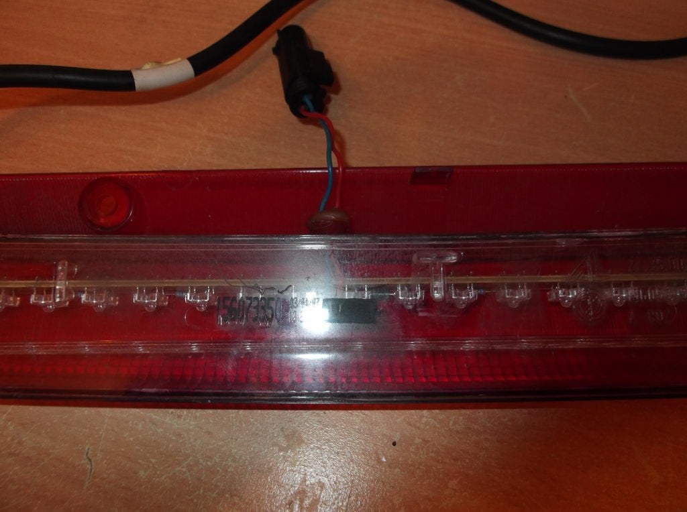

# The Cylon

A drop-in replacement for the high-level (third) brake light in the Alfa Romeo
159 — and, with minor fettling, the Brera and 939 Spider.

The factory unit is not an LED light at all. It is a row of filament bulbs on a
common rail that clips into the back of the reflector housing. The Cylon
replaces that bar with ten individually PWM-controlled high-power red LEDs
driven by an ATmega328P and a TI TLC5940, so the light can do something more
interesting than simply switch on.



## What it does

The unit only has power when the brake pedal is pressed, so the effect sequence
runs from boot every time and needs no interrupts or external switches — a
`millis()` counter is enough, because it always starts from zero.

| State | Effect | Duration |
|-------|--------|----------|
| 1 | Full on, all ten LEDs at 100% | 2 s — covers short dabs of the pedal |
| 2 | Breathe: 100% → ~25% → 100% | ~12 s (3 cycles) — covers normal slowing |
| 3 | Larson scanner | indefinite — you are stopped or in traffic |

Plus an MOT bypass: a single switch that holds the unit in plain full-on mode
for a tester who objects to the effects.

## Safety design

Two properties mattered more than the effects:

**Instant on.** The V3 prototype had ~300 ms of delay between the car's brake
lights and the Cylon lighting, which is the ATmega loading the bootloader and
starting the sketch. 300 ms is roughly the reaction time of the driver behind
you, so it was not acceptable. From V4 the LEDs are held on by 2N7000 MOSFETs
the instant +12 V appears; once the micro has booted it pulls the gate feed low,
opens the MOSFETs and takes over ground for PWM. Start-up is under 10 ms.

**Fail-on redundancy.** That same MOSFET arrangement means that if the ATmega or
the TLC5940 die, the LEDs still light at full brightness — they just stop doing
effects. The components most likely to fail cannot leave you without a brake
light.

## Repository layout

```
Cylon_5_2.ino              Production firmware (V5.2)
firmware/development/      Full V1 → V5.2 lineage, see firmware/HISTORY.md
hardware/                  Schematics, PCB, breadboard and cable layouts
hardware/LED-Specs.txt     The two LED types actually used
docs/                      Build notes and images
```

## Building it

1. Arduino IDE 1.0 or later.
2. Install the [TLC5940 Arduino library](https://github.com/PaulStoffregen/Tlc5940)
   (originally `code.google.com/p/tlc5940arduino`, now dead) into your
   `libraries/` folder. Nothing compiles without it.
3. Open `Cylon_5_2.ino`, select your ATmega328P board, upload.

To edit the hardware you need [DesignSpark PCB](https://www.rs-online.com/designspark/pcb-software)
(free). A PDF render of the V5.2 schematic is in `hardware/` if you only want to
read or print it.

## Physical constraints

The replacement had to fit the factory housing: a 300 × 16 × 30 mm envelope,
with LEDs spaced roughly every 30 mm. That ruled out a single board, so the
design is two — an LED board and a logic/power board — bolted together with
nylon bolts and spacers and joined by a ribbon cable carrying power and PWM.
Power and earth go back to the original high-level brake light connector; no
other wiring changes.

## Legality

Read [docs/LEGALITY.md](docs/LEGALITY.md) before fitting one. Short version: a
flashing or sequencing high-level brake light is **not** road legal in the UK or
under ECE regulations. This is published as an engineering project. The MOT
bypass switch exists for a reason.

## Credits

Code and hardware by Jay Abbott (jabawoki). Special thanks to **Rob C** for
expert support and advice throughout — his state-machine rewrite is preserved in
`firmware/development/Cylon_Rob_V1.ino`. Thanks also to the Alfa Owner forum
members who tested, questioned and pushed the design along.

## Licence

MIT — see [LICENSE](LICENSE).
